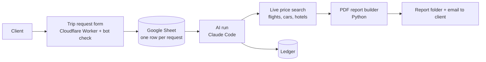
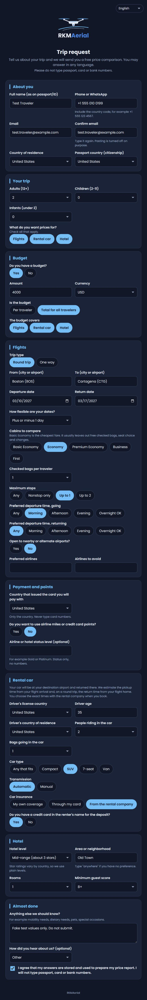
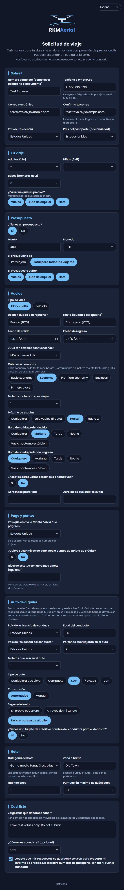
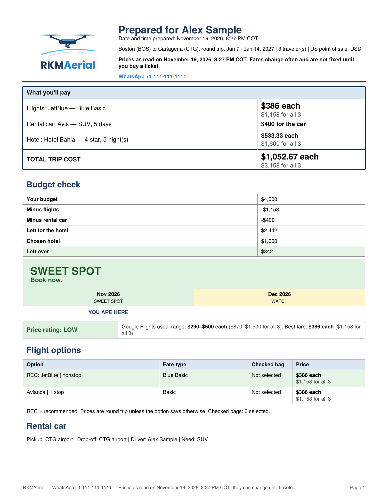
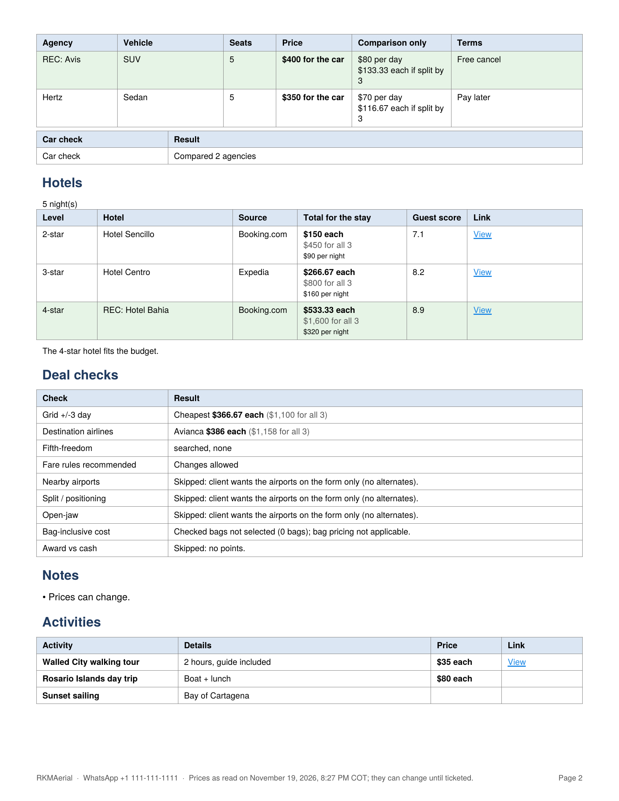
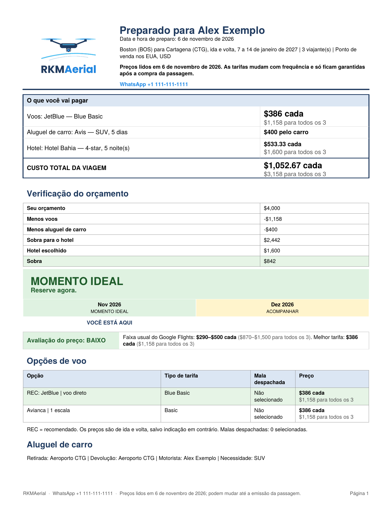

# FARE

**An AI-assisted trip-pricing service: a client fills in a form, and an emailed PDF fare report comes back with live prices for flights, rental cars and hotels.**

Designed and directed by Rafiq. Built with Claude.

> [!NOTE]
> **This is the public page.** The source is private on purpose: it handles real trip requests from real people. This page shows what FARE does, how it is built and how it is kept safe. Hiring, or want something like this built? [Email me](mailto:rkmaerial@gmail.com).

---

## What it does

1. **A client fills in a trip request** on a web form in 13 languages: flights, a rental car, a hotel, at least one.
2. **A Cloudflare Worker serves the form and saves each submission,** behind a bot check (Cloudflare Turnstile).
3. **Each request becomes one row in a Google Sheet.**
4. **An AI run reads the sheet.** A Claude Code session takes each ready request in turn, searches live prices through search connectors, and stops on a failure, a missing answer or any step only the owner can take.
5. **A report builder writes a branded PDF**: fares, car and hotel options, an optional price rating, and a one-line timing note for US trips.
6. **The PDF is saved to a report folder and emailed to the client.** The run writes a line in a ledger. Nothing is ever booked.

## Screenshots

Every picture below comes from a real run of the real program on test data: a made-up traveler and made-up contact details, not a client.

**The trip request form,** filled in with test values (not submitted). It runs in 13 languages; here in English and in Spanish.

 

**The fare report,** built by the report builder from a test input: what the trip costs, a budget check, a timing note, flight, car and hotel options, and the checks that were run.

 

The same report in Portuguese, one of the languages a client can ask for:

## What this demonstrates

| Skill | Evidence in this project |
|---|---|
| **AI implementation** | A working pipeline from a client's form to a finished report, with an AI run in the middle that is told exactly what it may do, when to stop, and what only the owner may decide. |
| **Prompt-injection defence** | Every form answer is treated as data, never as an instruction. A "looks suspicious" flag stops the row. Test rows are skipped unless named, and the sheet tool refuses a test row without an explicit flag. |
| **Secrets and access** | Secrets live in the platform's secret store, the operating system's credential store and an encrypted backup, never in a page or a repository. The sheet is restricted, its header and client columns are protected, and mail goes out through a dedicated sending account. |
| **Automation with APIs** | A form served from a Cloudflare Worker, the Google Sheets API through a service account, search connectors, a Python PDF builder, mail, and scripted backups, joined into one flow. |
| **Human in the loop** | It never books and never charges. Nothing is sent or deployed without the owner's word, and a request is marked handled only on the owner's say-so. |
| **Operations discipline** | Daily folder and sheet backups, an encrypted vault copy of credentials, a short handover written at each wrap, one running to-do list, and decisions logged with dates. |
| **Directing AI to build** | Written rules, form checks before every deployment, every report sample rebuilt and looked at after a change to the builder, and git history in both repositories. |

## How it is built

| Part | Where it runs | What it uses |
|---|---|---|
| Trip request form | Cloud | Cloudflare Workers, Turnstile, JavaScript |
| Requests and ledger | Cloud | Google Sheets, Google Drive |
| The AI run | The owner's laptop | Claude Code, search connectors for flights, cars and hotels |
| Report builder | The owner's laptop | Python, reportlab, PyMuPDF, openpyxl |
| Tools and backups | The owner's laptop | Node, PowerShell, a service account for the sheet, Windows Credential Manager |

About 150 KB of Python, 80 KB of JavaScript and 15 KB of PowerShell.

## Status and honest limits

- **Working.** The form, the report builder and the AI run have handled real requests from people other than the builder, ending in an emailed report, since 8 November 2026.
- **Car prices are estimates.** The form has no driver-age field and taxes are not stated.
- **The timing note is a hint.** It has no sourced booking window behind it.
- **Key rotation has not been tested for real.**
- **One owner, run by hand.** It is a one-person service, not a multi-user product.

## About the builder

I'm Rafiq, founder of RKM Aerial. I design and direct software and build it with AI: a clear vision, written rules, a check for each step, and nothing called finished until it is shown to work. I am looking for AI implementation, AI security and AI automation roles, and I can build something like this for you.

- **Contact:** [rkmaerial@gmail.com](mailto:rkmaerial@gmail.com)
- **My larger project:** [Khadijah](https://github.com/rafiqkmateen/khadijah), a private voice-driven AI assistant with a safety gate between the model and the user's life.
